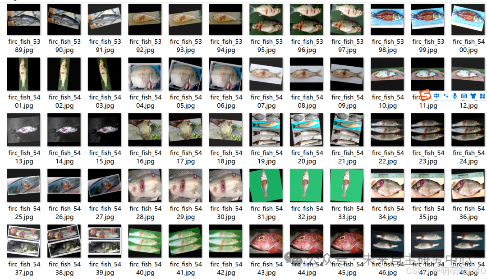
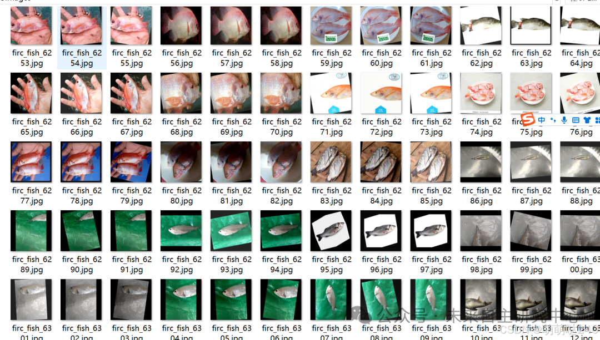
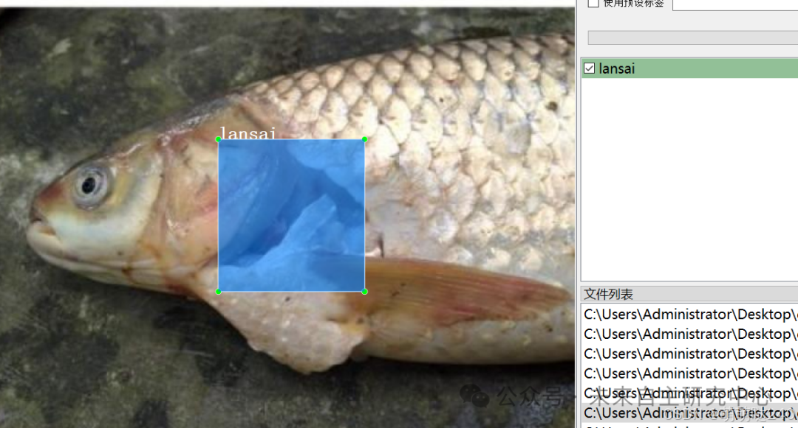

# [Dataset] [Object Detection] Fish Disease Detection Dataset VOC+YOLO format with 8474 images in 4 categories

Important Notice: The dataset consists of 2/3 enhanced images. Please carefully review the image previews to confirm they meet the requirements before downloading.

Dataset format: Pascal VOC format + YOLO format (txt file without split path, only containing jpg images and corresponding VOC format xml files and yolo format txt files)

Number of images (number of jpg files): 8474

Number of annotations (number of xml files): 8474

Number of annotations (number of txt files): 8474

Labeling category count: 4

Label category names: ["kuiyang", "lansai", "qisunshang", "yanbing"]

Number of boxes labeled in each category:

Kuyang (ulcer) frame count = 7085

Lansai (rotten cheek) frame count = 2016

Qi Sun Shang (Fin Damage) Frame Count = 2380

Yanbing (eye disease) frame count = 2147

Total frames: 13628

Using labelImg:

Annotation rules: Draw a rectangle around the category.

Special : This dataset does not guarantee the accuracy or precision of the trained models or weight files. The dataset is provided with accurate and reasonable annotations only.

Image Preview:

Annotation example:

## Payment

Here is a pay link on Stripe ( https://buy.stripe.com/3cs8yP7sY87d0vu9AB ). Please contact me lonlonago@foxmail.com after funding $89, and I will send you a complete data files , thank you!

